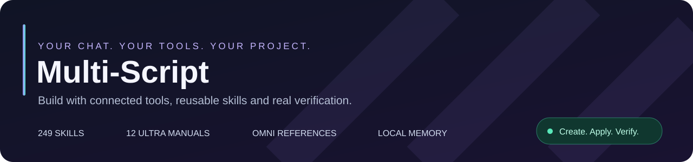

# Multi-Script

   

Multi-Script connects supported AI chat websites to **Roblox Studio, Unity, Godot, Blender, Figma and headless Blockbench** through a local tool bridge. Keep your provider, your project and your workflow. Engine access follows the active session and its permissions.

| Capability | What you get |
| --- | --- |
| **Create** | Native project tools and editable source assets |
| **Reuse** | 249 skills, 12 Ultra manuals, OMNI references and Forge art generation |
| **Remember** | A root Obsidian vault with scoped project notes and bounded recall |
| **Verify** | Real tool results, readback, captures and executed checks |

**[Download & install](https://github.com/krazydarky-code/Multi-Script/releases/latest)** · [Setup guide](docs/INSTALL.md) · [Ultra workflows](docs/ULTRA_MANUALS.md) · [Obsidian memory](docs/OBSIDIAN.md) · [Update guide](docs/UPDATES.md)

## Ultra resource discovery · 6.50.1

Ultra loads a compact selection of relevant manual excerpts, OMNI reference observations/recipes, Forge capabilities and available project memory with your original task. It reuses those reads; the complete library remains available on demand. OMNI exposes its actual source/recipe packages and can preview reference pages from the original PDF imported into your vault. Generated assets still require real project integration and verification.

Run **Setup.bat** (or the platform Setup launcher) in the complete permanent folder, then load `extension` in your browser. Setup connects **Multi-Script Memory** beside `extension` and `runtime`; private notes, imported originals and projects survive signed updates. Reload the extension and refresh existing provider tabs after an update.

## Community & support

| Join the community | Support development |
| --- | --- |
| **[Multi-Script Discord](https://discord.gg/5Q6vvNcpM6)** — setup help, workflow discussions and project sharing. | **[Multi-Script on Ko-fi](https://ko-fi.com/multixscript)** — optional support for continued development. |

GitHub’s **Sponsor** button opens Ko-fi. Bug reports and feature requests remain available through [Issues](https://github.com/krazydarky-code/Multi-Script/issues); Discord and Ko-fi also appear in the issue chooser. Donations do not unlock provider subscriptions or bypass their limits.

Current packages: `Multi-Script-6.50.1-Dev.zip` and `Multi-Script-6.50.1-Bundle.zip`, with the unchanged `Multi-Script-6.42.0-Public.zip` companion. The running terminal should report `Multi-Script Bridge v6.50.1`.

## Delivery & coverage

Dev uses a public signed feed; users need no GitHub account. Tested main commits publish through the scoped release workflow, serial uploads and immutable versioned assets. See [delivery safeguards](docs/GITHUB_DELIVERY.md) and [6.50.1 verification](docs/QA_6.50.1.md). Tests document their actual coverage; they do not certify every signed-in provider account or device.

<strong>6.50.0 features, setup details and earlier improvements</strong>

# Multi-Script 6.50.0 — deeper existing Ultra methods

The **ChatGPT native transport** correction reads real editor documents, applies rich-text drafts in one native edit where supported, and ignores placeholder decorations. It retains exact-message checks and one acknowledged Send. Reload the extension **and refresh every provider tab** after merging the corrected extension files into an existing 6.50.0 installation; the MAIN-world editor bridge must reload too. A version-only updater cannot detect this same-version correction. Saved projects, configuration, skills and earlier features remain.

Use the **chatbar cube icon** or **extension popup → Open Blender Workspace** for a Three.js modeling/animation viewport backed by real headless Blender. Setup prepares a verified portable runtime on Windows; projects auto-save as .blend, with GLB/FBX exports and real Cycles renders. [Setup and usage](docs/BLENDER_WORKSPACE.md).

Ultra now has 564 phase checkpoints: all 480 previous checks plus 84 direct expansions based on the supplied UI, world and creature references. The same twelve manuals, nine production styles, five broad style methods, 72 phase exits, 72 acceptance criteria, 48 diagnostic cases and all 249 original skill definitions remain. Existing skill reads and GUI/animation workflows receive the added detail. [Full handbook](docs/ULTRA_MANUALS.md). Startup stays compact; relevant full or phase-specific methods load for the actual task. Ultra preserves its skill requirement when web research is skipped, and native private AI dialogs retain the toolbar. [Restored specialists](docs/SPECIALIST_RESTORATION_6.48.5.md).

ChatGPT detects labelled textareas, rich text and open shadow-root composers as well as the current textarea composer and transcript alongside its legacy layout. Effort instructions and skills still travel in one complete native user message. Method display chips have been removed: Multi-Script no longer masks or resizes your sent prompt, and sending does not wait for cosmetic receipt storage.

Provider detection rejects native hidden/inert turn and composer copies. ChatGPT separates reasoning from final replies and uses one acknowledged send after attachment readiness. Venice/Vani ignore historical busy controls; Vani honours active quiet-thinking flags. Navigation and cancellation prevent sending into a changed chat. Regression fixtures exercise these paths; authenticated provider layouts still need live account verification.

Native model/effort/settings menus keep their click targets when they overlap the toolbar. Gemini checks complete drafts, respects Stop during insertion and refuses silent text-only sends after a failed image upload.

Auto dock preserves toolbar sizing and rounded controls across dock switches. Task progress remains available before a run. Gemini preserves multiline input, waits throughout quiet thinking, and pauses on its explicit error reply. ChatGPT supports role-tagged and article-based transcripts.

Notion Auto follows the native composer rather than forcing a bottom-of-window dock. Bars share the same controls and clipped status layout inside or outside their settings root.

Signed in-place updates finish launcher registration and verify its installation/version automatically. If setup fails, Updates offers **Finish setup** with settings preserved. A manually extracted new folder still needs its own **Setup.bat** once. Crax is no longer an active provider.

The 241-skill v24 base is preserved. Eight rewritten specialists bring the current total to 249, with two restored Blender guidance workflows. **Check-Clean-UI** and **Check-Props** remain built-in standards. The AI runs their checks privately and gives the user a short plain summary. See [Check Suite](docs/CHECK_SUITE.md).

## Production methods and workspace tools

The Updates panel now reports download/install progress, checks the registered folder and recovers interrupted updates while preserving private settings. Ultra's Roblox GUI and animation workflows were rewritten from the supplied quality references and linked to twelve existing skills. [Update setup](docs/UPDATES.md) · [Scoped Ultra methods](docs/ULTRA_MANUALS.md) · [Verification](docs/QA_6.50.0.md).

The rebuilt Roblox Studio Workbench has Overview, Toolset, Console and Guide tabs, per-tool checkboxes, editor-safe source changes and large-source staging. Tool inspection resolves actual native/toolkit/companion schemas. Notion pauses after an unconfirmed send. [Roblox setup](docs/ROBLOX_PLUGIN.md) · [Workspace modes, sounds and animation](docs/MODES_AND_MEDIA.md).

This package includes the browser extension, local bridge and source. Use only one edition at a time. Extract it to a permanent folder, run Setup.bat on Windows (or Setup.sh / MacOS_Setup.command), then load the `extension` directory as an unpacked Chrome/Edge extension. Reload already-open provider tabs and restart the bridge to load this version. Your appearance preferences are kept in browser storage.

Figma now has a bundled **native companion MCP server and plugin** for inspecting the current page, creating/editing frames, components and text, importing SVGs and exporting real captures. Pair it explicitly and choose Read or Edit inside Figma. [Figma setup](docs/FIGMA.md). The actual signed-in Figma host is not live certified by the API-mock tests.

ClickUp is restricted to a visible private Brain conversation. Team chat/task comments are excluded; sends recheck the chat target and wait for generation to settle. [ClickUp setup and limits](docs/CLICKUP.md). The redesigned **Provider benchmarks** compares transport evidence across all 15 adapters with searchable rows and a local readiness check; subjective speed/intelligence ratings were removed.

Ultra adds **12 specialist manuals** with inspect/design/build/integrate/verify/failure-recovery sections. GUI, animation/rigging, VFX, modeling, worlds, gameplay, audio, networking, performance, engineering, accessibility and QA work together through relevant excerpts and full local retrieval. These are in-context methods, not weight training. [Ultra manual system](docs/ULTRA_MANUALS.md).

Ultra now adds detailed craft/style research methods and target playbooks for Roblox Studio, Godot, Unity, Blender and desktop Code/Software Builder. All 241 built-in skill contracts return domain-specific craft guidance. Full manuals stay behind the scenes and lower effort disables Ultra immediately.

**Settings → Help → Updates** stages signed Dev releases through the native host and preserves settings/private files. The release feed and public signing key are configured for [krazydarky-code/Multi-Script](https://github.com/krazydarky-code/Multi-Script/releases/latest). After the one-time manual upgrade to this configured build, users can check/download updates inside Multi-Script and apply/reload when idle. The [update guide](docs/UPDATES.md) explains the user steps and automated publishing.

Open the separate **Run monitor** from the task and phone icons in the chatbar or **Settings → Co-work**. Complex tasks can report concrete steps, blockers and verification evidence; the remaining count never advances just because a tool chip succeeds. **Phone control** pairs an ordinary phone browser on your trusted local Wi-Fi to view progress, queue follow-ups/corrections/goals, pause/resume the queue and request Stop in a selected provider tab. It is off by default. [Phone setup and limits](docs/PHONE_CONTROL.md).

Open Settings → Agent to use the reasoning slider: Adaptive → Quick → Standard → Deep → Maximum → **Ultra**. Ultra is the slider's final stop. All live themes also render behind the chatbar and respect its independent theme and motion preference.

The chatbar uses a compact, accessible **New idea** icon. Code Flight has its own **Workspace → Code Flight** tab. **Critic review** is now a setting under **Agent**, alongside the effort slider: enable it and choose one to three review passes. It adds review instructions to every task prompt, including when the prompt enhancer is off, without sending extra review messages after completion. Sandbox/Ask is also in Agent settings; the Studio popover was removed.

Ultra adds a task-specific workflow for researching relevant games and art/UI references, recording source URLs, choosing a consistent style bible, integrating assets, playtesting and comparing real screenshots. It uses only available research/capture tools and reports missing access. Provider-native research can coexist with Multi-Script's ordinary JSON local-tool transport.

Vani guest chat at `c.vani.ai/chat` is recognized through its observed turn roles, with tool chips and text-only vision fallback. Selected skill results now include bounded execution and verification methods. See [6.41 test evidence](docs/PROVIDER_QA_6.41.md) for fixture and live boundaries.

The run monitor shows automatic response stages or the detailed task plan, current stage, remaining work and rough estimates when supported by step data. Both task progress and phone control are compact chatbar icons. Ultra now bounds repeated reads, requires available references/full methods for substantial builds, and keeps missing evidence unverified. All six effort levels deliver their scoped method; all 241 skills keep their IDs with v6 contracts. [Phone setup and Discord tutorial](docs/PHONE_CONTROL.md).

Settings has dedicated **Code & Build**, **Skill workshop** and **Co-work** tabs. The workshop is usable locally; a shared community service requires hosting the included server. [Workshop setup](docs/WORKSHOP.md), [release notes](docs/release-notes/RELEASE_NOTES_6.50.0.md), [provider verification](docs/PROVIDER_QA_6.41.md), [live tools guide](docs/TOOLS_GUIDE.md).

The development edition adds no product caps. The public edition limits edit/write payloads to 256 KiB, each command to 60 seconds and disables background commands. The existing workspace root and Run commands permissions still apply in both. Edition settings do not unlock paid provider subscriptions or bypass quotas.

Screen recording produces an actual MJPEG AVI of at most five seconds plus sampled frames for AI inspection. Setup installs Pillow; the OS must allow screen capture. Source assets, engine imports and final results still require real connected tools and, where applicable, asset-upload permissions.

DeepSeek uses single-dispatch sending and normal configured pacing with shared-tab coordination; automatic error recovery is disabled for that provider. The fixed 20-second floor and six-turn burst cap from 6.48.6 are removed. Pacing cannot guarantee account access. See [DeepSeek account access](docs/DEEPSEEK_ACCOUNT_ACCESS.md).

Vani and ClickUp live authenticated support is unverified. Venice Classic and Agentic Chat were inspected live. Agentic guest chat produced local-tool JSON and read a result executed by the actual Python runtime. The full automatic content-script chain was separately tested against an Agentic DOM fixture with real local skill retrieval and SVG creation. DeepSeek V4.1 Flash Uncensored is a provider/account model selection; this package preserves it but does not unlock or claim to have tested that paid model. See the provider QA document before relying on a new provider.

Download `Multi-Script-6.50.0-Bundle.zip` and install **`Multi-Script-6.50.0-Dev.zip`** from it. Dev is the primary, current build and receives all ongoing updates. The bundle also includes the unchanged `Multi-Script-6.42.0-Public.zip` as a frozen older companion; it does not contain the latest fixes. Both contain full source, extension and local bridge. The Dev bridge terminal should report `Multi-Script Bridge v6.50.0` after you restart it. Do not mix the extension from one edition with the runtime from another.

Local preferences use browser storage. Skills, workshop entries and co-work tasks live in `runtime/studio-data/`; recordings are local to that directory. Keep your private runtime data outside distribution archives. The release builder excludes it, secrets, connection tokens, logs and generated artifacts, and uses the example MCP configuration.

Run `python tools/release_check.py` for the packaging gate. Build with `python tools/build_release.py --output release --public-archive /path/to/Multi-Script-6.42.0-Public.zip`. The builder creates only the current Dev build and bundles the checksum-pinned Public snapshot unchanged. Missing, modified or equally/newer-version Public archives fail the build; Public is never silently regenerated. See [release policy](docs/RELEASE_POLICY.md) and [current release QA](docs/QA_6.50.0.md). Tests for the revamp are `tests/test_studio_hub_637.py`, `tests/test_studio_revamp_637.js` and `tests/test_new_provider_transport_637.js`. The current overhaul and executed checks are in `docs/WORKSPACE_REVAMP_6.42.md` and `docs/QA_6.42.md`; live-provider boundaries remain in `docs/PROVIDER_QA_6.41.md`.

Multi-Script remains GPL-3.0-or-later; see LICENSE and the third-party notices. [Discord support](https://discord.gg/5Q6vvNcpM6).

Lowering effort clears the visual activation and supersedes prior Ultra policies. Theme surfaces and live scenes remain intact, and reduced motion/forced colors are supported. [Integration details and attribution](docs/SOURCE_METHODS.md).

6.40 adds the searchable Skills library, the project-aware (now 241 after the 6.48.2 prune) skill contracts, grouped settings navigation, queued co-work follow-ups and a dependency/resource-aware shared task board. Native generation errors pause with task-unverified status; green chips describe individual tool calls. [Workspace revamp guide](docs/WORKSPACE_REVAMP_6.40.md).

6.42 adds editable/reorderable correction and goal queues, project filtering and priority sorting, acceptance-check/evidence/blocker completion gates, scoped enabled skills, Markdown import and project-pinned library methods. Ultra now carries a four-stage delivery contract. Code Flight is rebuilt around the actual MS icon, three worlds, Arcade/Practice modes, precision scoring and visibility-aware pausing. Six additional themes include live Tidal, Starlight and Daybreak scenes across the menu and chatbar.

Provider sessions now discovers open supported tabs, reads bounded briefs locally and assigns shared tasks through each target’s own acknowledged transport. Vani waits for native generation to finish and a quiet interval before feedback; startup can be cancelled. Shared-task and acceptance-check counts show remaining work. The dashboard supports phone widths; remote phone pairing is not included.

### 6.50.0 local asset and reference support

Setup creates a connected **Multi-Script Memory** Obsidian vault in this installation root. The library and imported original archives/media stay outside extension code and are preserved by updates. See [vault setup](docs/OBSIDIAN.md). Headless Blockbench preparation and its optional renderer are in Settings → Engines; see [Blockbench setup](docs/BLOCKBENCH.md). These additions extend the existing skills and Ultra manuals.

