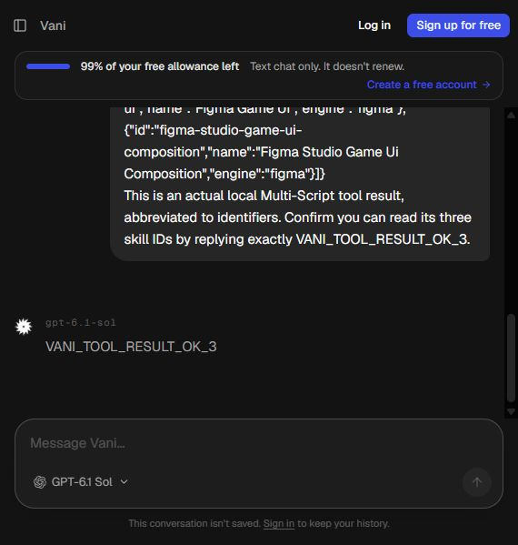
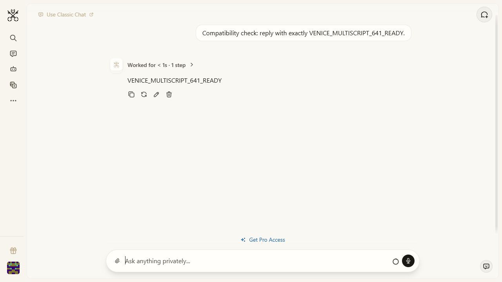
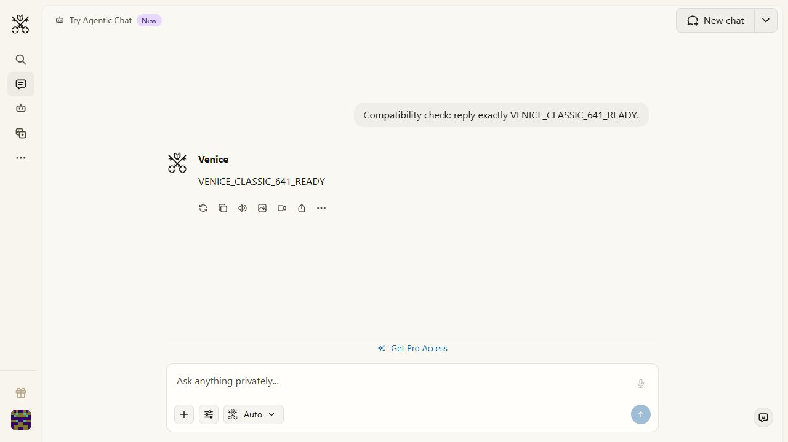
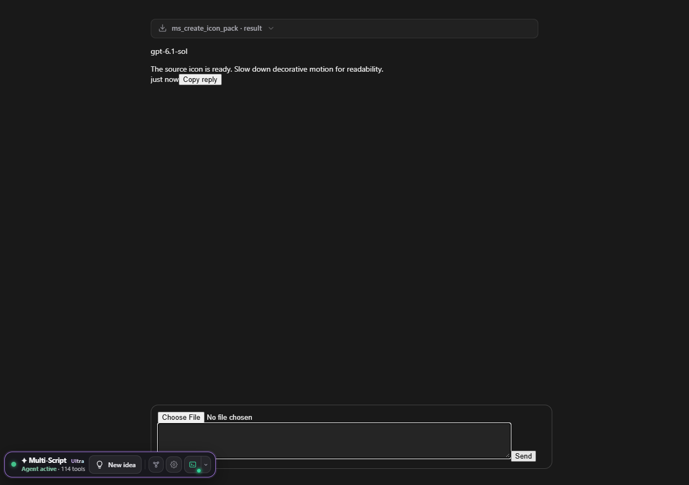

# Multi-Script 6.41.0 verification — 17 October 2026

**153 regression suites returned success: 94 JavaScript and 59 Python.** This includes real headless Chrome tests of all 16 shipped provider adapters, full content-script chains, three provider/runtime exchanges, and the complete settings/theme sweep. Environment skips and live account limits are recorded below. These results do not certify every third-party model, account or future website change.

[Machine-readable suite results](verification-results-6.41.json) · [Read-only live-site probe](live-provider-probe-6.41.json) · [Release notes](release-notes/RELEASE_NOTES_6.41.0.md)

## Repairs verified in this release

- **Vani guest chat:** opening `https://c.vani.ai/chat` reaches `/c`; opening the bare domain can reach marketing. The adapter recognizes the observed `public-composer`, `data-turn-id`, model label and user message-action roles. It excludes model labels, timestamps and copy controls from response text. The preferred composer wins over unrelated search textareas. Guest chat advertises no vision capability, allowing Multi-Script's text fallback rather than a nonexistent upload attempt. Authenticated workspace layouts remain separately unverified.
- **Chips and parsing:** hidden tool-command source remains readable after chip masking. Chip bodies never become assistant commands. DeepSeek's extraction previously included inserted chip labels and expanded bodies; all three extraction entry points now exclude them. The shared adapter exposes stable turn keys, including IDs on parent wrappers, so virtualized Vani turns do not collide merely because they reuse the same visible index.
- **Venice:** both Classic and Agentic layouts were inspected live. Agentic final prose remains separate from native thinking/tool-step panels. Split final prose roots are read together. Observed `data-is-error` and `data-isratelimited` flags now pause the response loop before it can classify partial text or a command as success. Resume waits for the native error state to clear. Existing Retry/Clear failure detection and explicit no-replay behavior remain covered.
- **Transport boundaries:** send controls are scoped to the actual composer; an unrelated submit button cannot become the fallback. Input locks are reapplied after a composer remount and restore prior editability. A quoted alert inside a message is excluded from the shared site-error scan. Unconfirmed sends stop instead of being automatically replayed.
- **Applied skills:** the director's result now carries up to six relevant inspect/execute/verify workflows alongside retrievable IDs. It explicitly preserves the user's scope and skips unrelated methods. Read-only project discovery is classified as engineering validation, with matching completion policy and capability-index metadata. Duplicate tags were removed. Figma custom workflows retain their engine in both UI and runtime. All 904 skill contracts, related references and named tool references were audited; no missing tool references justified deleting valid workflows.
- **Discovery and recovery:** legacy tool aliases resolve to an advertised canonical replacement. Workflow selection reserves a first choice for each phase before filling extras, and reports missing implementation coverage. Player movement search avoids prioritizing file moves. The shared Unix shell helper now has LF line endings.

Critic stays in Agent settings and augments task prompts. Ultra stays at the final stop of the native six-position effort slider. This release introduces no extra Studio button or popup. Skills and effort are in-context instructions; they do not train model weights, grant missing tools, select a paid model, change provider quotas or guarantee model obedience.

## Headless coverage

| Test area | Actual coverage |
|---|---|
| All 16 providers | Shipped content chains, real adapter role detection and parser, chip source isolation, Agent/skills UI, all six effort stops, Critic off/on and selected passes: **513 assertions** |
| Actual input/send implementations | Multiline Unicode, quotes, braces and literal markup; one send event, composer acknowledgement and the new user role on every adapter: **64 assertions** |
| Command envelopes | 231 existing direct-tool names plus four namespaced probes, across all 16 providers: **14,848 parser cases** |
| Vani guest, Venice Agentic, Venice Classic | Actual extension startup and send loop → Python skill discovery/catalogue → `ms_get_skill` → real editable SVG creation → tool-result delivery; Critic/Ultra prompt additions; installed workflow refresh; co-work receipt; deliberately unacknowledged delivery pauses without replay |
| Virtualization | Vani's runtime fixture discards older rendered turns on every exchange. Stable IDs keep new commands distinct even with a flat visible assistant count |
| Shared DOM edge cases | Hidden source, chip-body isolation, quoted alerts, stable identity after remount, composer lock/remount/unlock, scoped send, Vani preferred field and text-only guest vision, non-chat route refusal |
| Settings and themes | **458 controls operated**, theme/size/tab combinations, saved appearance and bar values, resets, search, narrow viewports, hostile storage; full theme sweep completed in about six minutes |
| Existing reliability | Provider failure/Resume, startup discovery, prompt enhancer gates, six-position Ultra, reduced motion/forced colors, worker pacing leases/cooldowns, no-replay guards, schemas, workspace, co-work and library regressions |
| Runtime | Every skill retrievable; applied workflows across six engines and three objectives; actual Lua VM execution; generated Roblox programs compile with the available Luau compiler; mock engine/native wire checks and isolated file operations |

Provider models and native editor connections in automated end-to-end tests are fixtures. The local Python catalogue, skill retrieval and SVG files are real. Fixtures exercise code paths; they cannot establish a paid model's compliance or a real editor playtest. A green chip describes an individual returned call, and a co-work receipt describes accepted delivery.

Several historical tests still expected removed effort buttons, older wording or pre-revamp skill metadata. They were updated to assert current behavior and rerun. One theme fixture omitted the shipped scene stylesheet; its full stylesheet chain is now loaded. A Windows mock material list that never grew caused an infinite test loop; it now models a mutable list. The minigame clock test throttles decorative RAF callbacks while retaining its actual 100 ms game timer; real-time theme rendering is checked separately. No failed test was relabeled as a pass without rerunning it.

## Live evidence and limits

The read-only probe used fresh unauthenticated headless Chrome contexts, with **zero messages and zero tool executions**. It evaluates adapter DOM reads and does not install the extension or exercise its native host. Separately, small guest response/protocol checks were performed through the interactive browser.

| Provider | Fresh live observation | Remaining boundary |
|---|---|---|
| Vani | Headless composer detected at `/c`. Interactive guest returned the requested JSON command, then read three real local skill IDs and answered `VANI_TOOL_RESULT_OK_3` | Interactive protocol delivery was manual; authenticated workspace, paid models, uploads and installed-extension live exchange remain unverified |
| Venice | Agentic guest and Classic guest returned exact readiness markers; their DOM selectors were inspected. Agentic composer also detected headlessly | Paid DeepSeek V4.1 Flash Uncensored selection and live local-editor execution remain unverified |
| Gemini | Guest composer detected | No live send/tool/paid-model test |
| Kimi | Guest composer detected | No live send/tool/paid-model test |
| GLM / Z.ai | Guest composer detected | No live send/tool/paid-model test |
| Qwen | Guest composer detected | No live send/tool/paid-model test |
| ChatGPT | Browser challenge page | No challenge solved; live account exchange unverified |
| Claude | Browser challenge page | No challenge solved; live account exchange unverified |
| Arena | Browser challenge page | Screenshot-shaped failure path passes in the headless fixture; authenticated exchange unverified |
| DeepSeek | CDN request-error page | Live exchange unavailable in this environment |
| Notion | Redirect to login | Authenticated exchange unverified |
| ClickUp | Redirect to login; private Brain scope guard remains closed | Authenticated private Brain layout unverified; ordinary human/team composers remain excluded |
| Meta AI | Public page, no supported guest composer detected | Authentication/DOM verification needed |
| PromptQL | Public home, no supported guest composer detected | Authentication/DOM verification needed |
| SuperApp | Marketing page, no supported guest composer detected | Authentication/DOM verification needed |
| Crax | `crax.gpt.lol` failed DNS resolution | Live compatibility could not be tested |

The public documentation distinguishes Vani Chat and API products and describes the guest chat: [Vani overview](https://vani.ai/), [Vani docs](https://vani.ai/docs). Venice documents separate Agentic and Classic workflows: [official Agentic announcement](https://venice.ai/es/blog/agentic-chat-is-now-live-on-venice), [official usage guide](https://learn.venice.ai/guides/how-to-use-the-venice-agentic-chat). Documentation supports product context; the live observations above come from this run.

### Saved visual evidence

Live Vani guest protocol acknowledgement, with no extension claimed to be installed:

Live Venice Agentic readiness response:

Live Venice Classic readiness response:

Actual extension UI on the Vani **fixture**, after local SVG creation and result delivery. Native page styling is deliberately reduced; this is not a live authenticated Vani screenshot:

## Environment boundaries

All 153 suites returned success. Four suites explicitly contain unavailable environment checks: Godot binary parsing/`--check-only` in two suites; real Blender `bpy` and Unity/.NET compilation in the native-pro suite; POSIX setup/start execution on this Windows host. Shell syntax was checked with Git Bash. Roblox Lua VM checks were enabled using a workspace-local Lupa dependency. Mock compilation and file checks do not replace native editor execution, multiplayer sessions or OS capture permissions.

Pacing remains bounded request spacing, shared cooldowns and quota pauses. It does not evade bans, bypass challenges or account limits, or unlock absent models. Zero bugs across every changing provider/account cannot be certified from this environment.

## Reproduction and installation

Run `python tools/verify.py all` from the source root with Node, Playwright/Chrome and the optional test dependencies available. `python tools/verify.py js test_provider_browser_matrix_641.js` runs the provider UI matrix. The runner isolates Studio data, records logs/results, distinguishes skips and gives the long theme sweeps an appropriate time budget. `node tools/provider_live_probe.js` performs only the unauthenticated read-only live probe.

Use matching 6.41.0 extension and runtime files from either full-source ZIP. Extract into a permanent folder, close the old bridge, rerun Setup there, reload the unpacked extension, then restart the bridge. Public retains its 256 KiB payload / 60-second command / no-background product caps. Dev has no added product caps; normal workspace permissions and provider access limits still apply. GPL source provenance and the supplied PlazCode license remain preserved.
