# Stud Creatures - a Claude skill by Goofy Studio

Ask Claude for any creature and get it in the epic blocky "stud" style used by stud pet games on Roblox: angular
bricks, angry glowing eyes, open jaws full of teeth, horns, spikes and armour - from a simple farm cow to a giant
three-headed hellhound. Every model comes **rigged** (a skeleton ready for Roblox's Animation Editor), as an **FBX
for Roblox's 3D Importer**, with a **setup script** that colours it and applies the studs (or leaves them out).

These are the reference creatures the skill learns from (in `examples/`). Every one of them is a working example
Claude can open and build on:

| Dragon | T-Rex | Cerberus | Hydra |
|---|---|---|---|
| 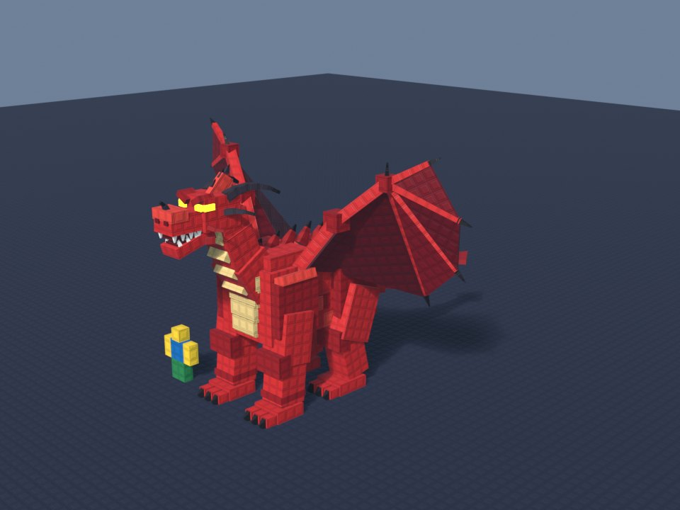 | 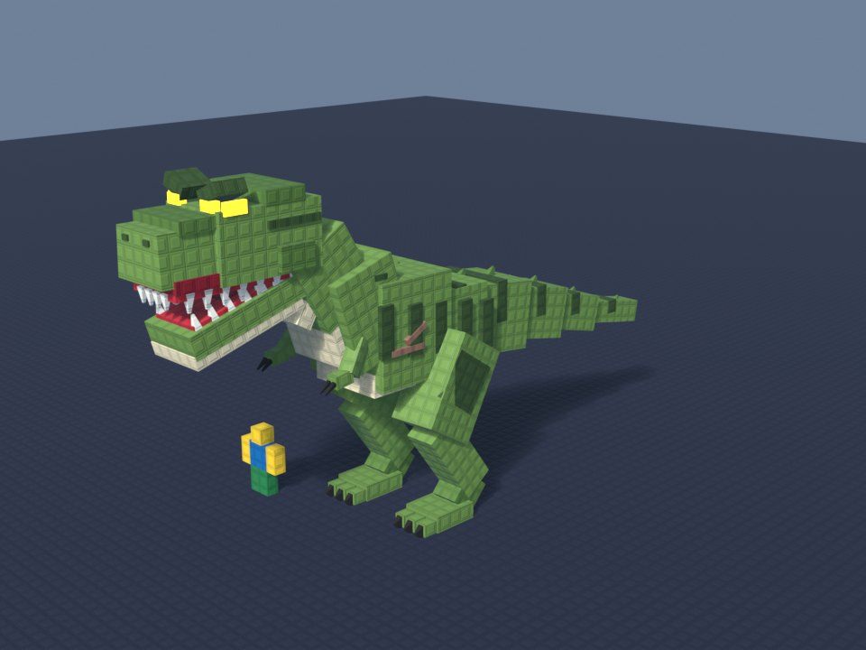 | 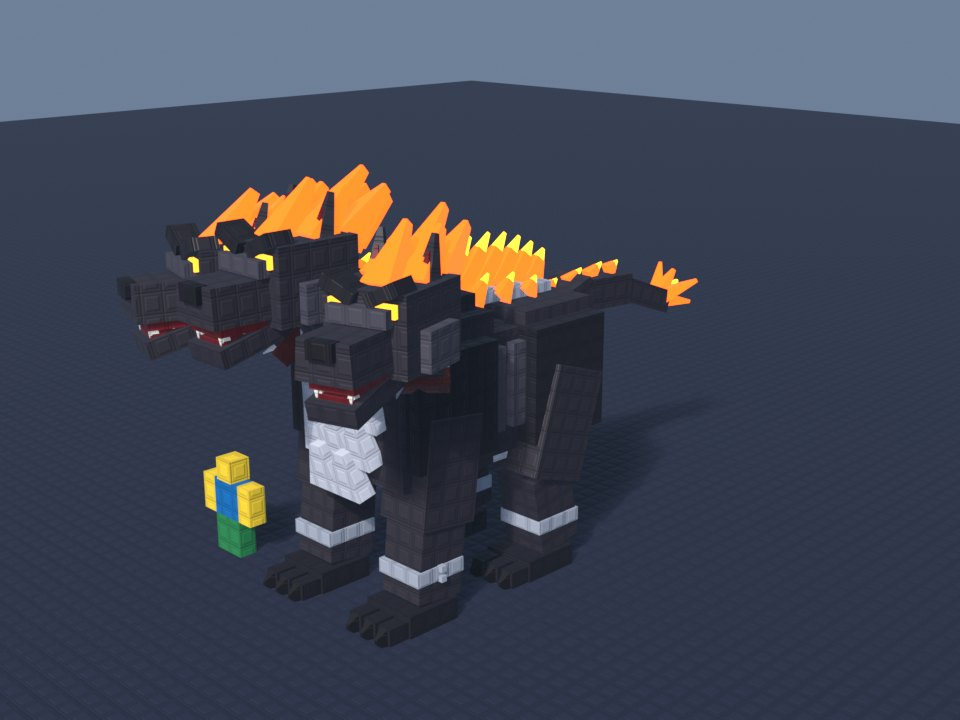 | 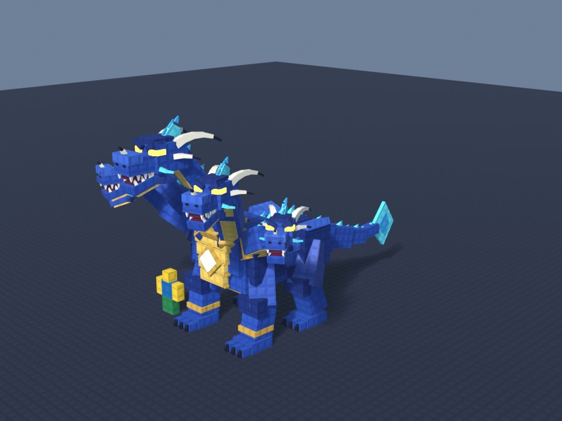 |

| Leviathan | Kraken | Megalodon | Titanoboa |
|---|---|---|---|
| 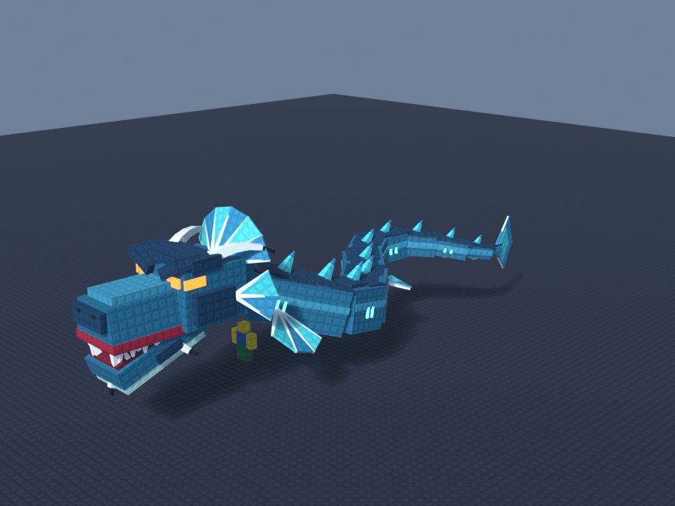 | 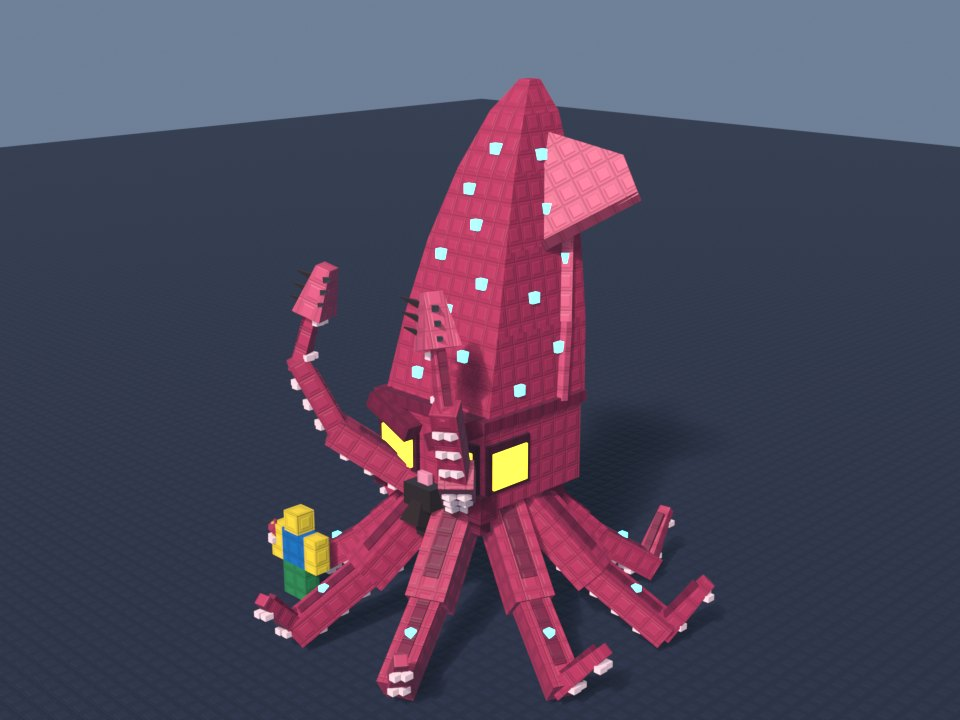 | 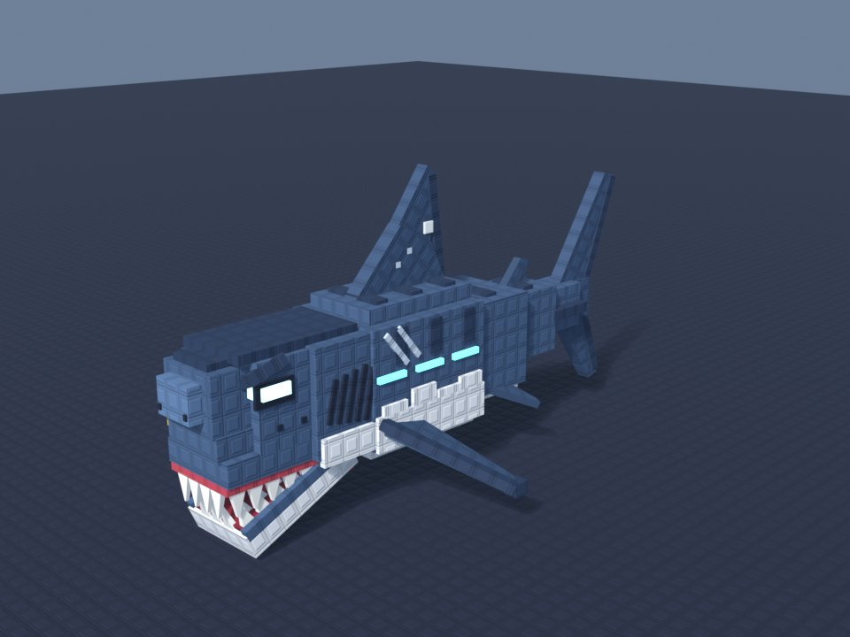 | 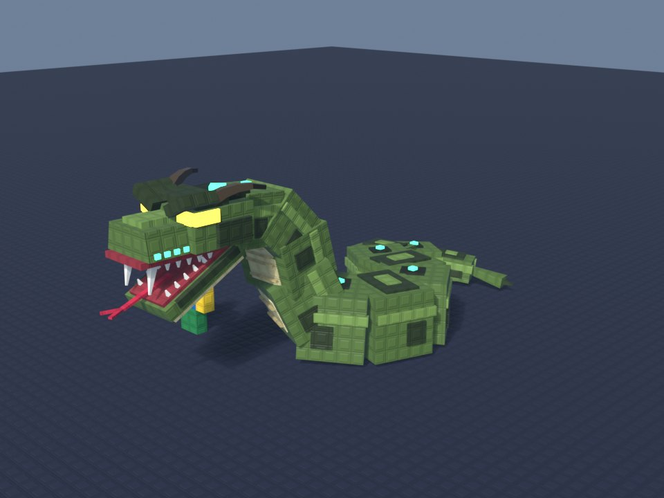 |

| Roc | Chimera | Arctodus | Cow |
|---|---|---|---|
| 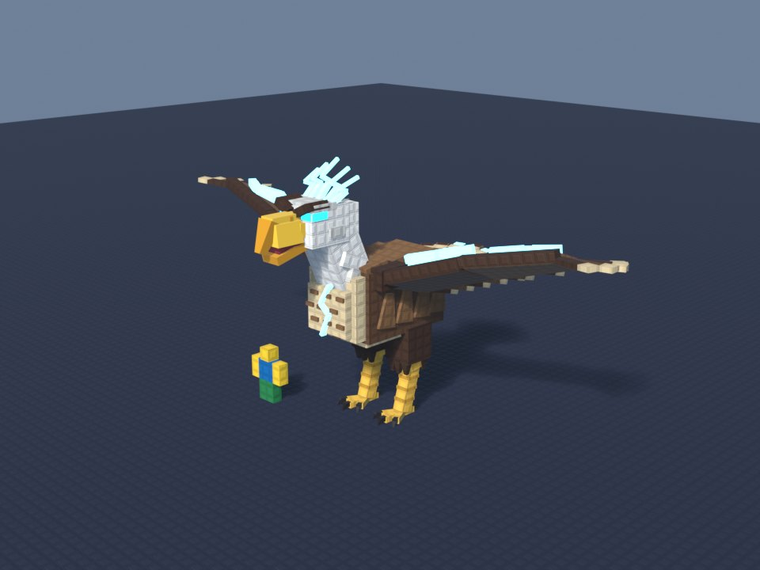 | 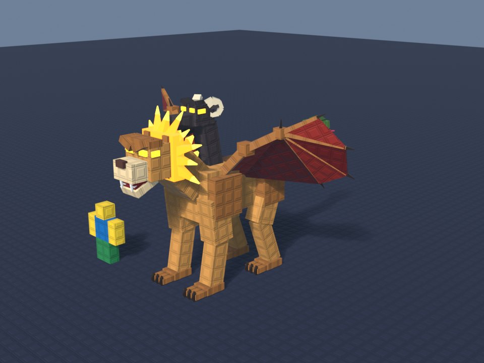 | 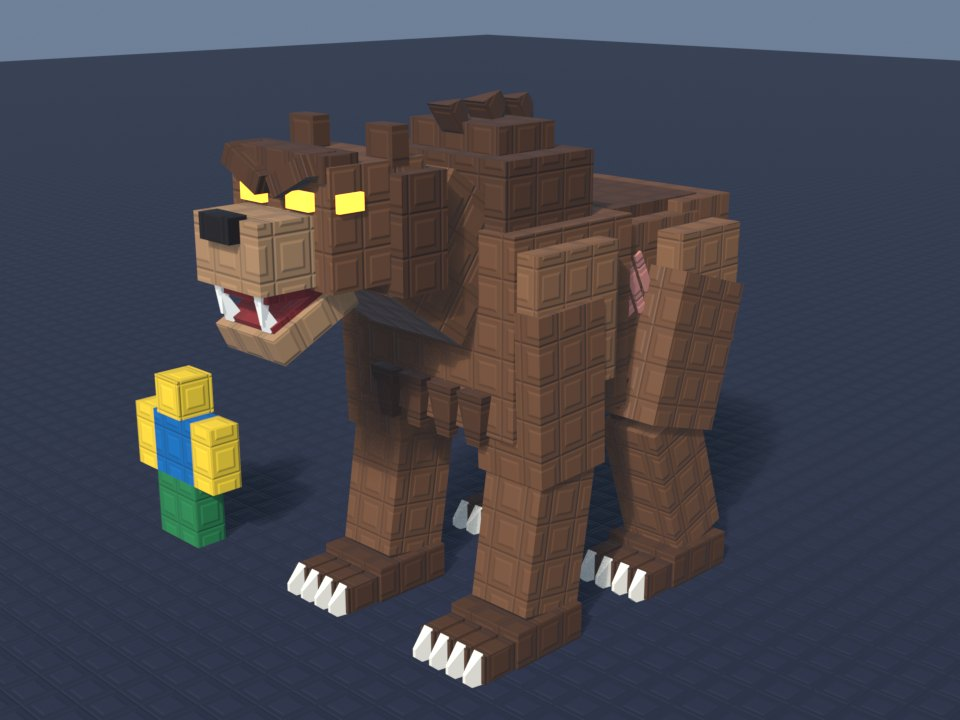 | 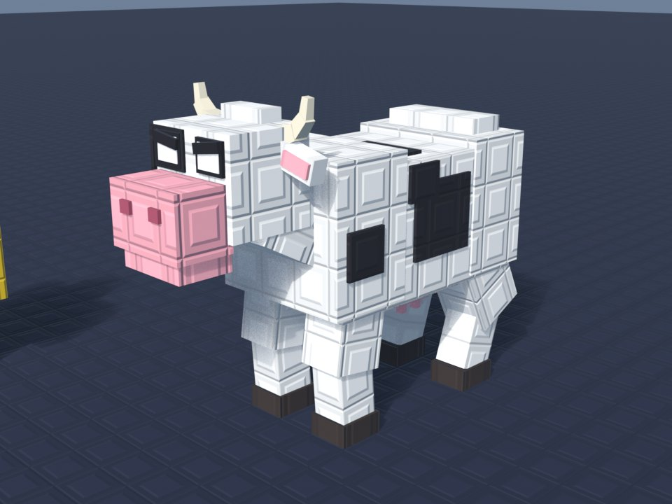 |

## What you need

- **Claude Code** (the terminal app or the Code tab of the Claude desktop app), because Claude runs Blender on your
  computer. The claude.ai website alone cannot run Blender.
- **Blender 4.2 or newer**, free from blender.org (5.1 is tested). Nothing else to install.
- Roblox Studio, to import the result.

## Install

Unzip `stud-creatures.zip` inside your Claude skills folder, so that `SKILL.md` ends up here:

- Windows: `C:\Users\<you>\.claude\skills\stud-creatures\SKILL.md`
- macOS / Linux: `~/.claude/skills/stud-creatures/SKILL.md`

(Create the `skills` folder if it does not exist.) Start a new Claude Code session and check with `/skills`, or
just ask "do you have the stud-creatures skill?".

Easiest way: give the zip to Claude Code and say "install this skill for me".

## Use

Just ask, in any language:

- "Make me a stud-style horse."
- "Hazme un mega dragón súper épico con el estilo de la skill."
- "A hydra with five heads, gold and blue, epic tier, about 60 studs tall."
- "The same wolf but without studs."

Claude writes the creature, renders it from several sides, checks it (nothing floating, no flickering faces, no
gaps at the joints), shows you the pictures and changes what you ask. When you are happy it exports
`<Name>.fbx` and `<Name>_roblox_setup.luau`. In Studio: File > Import 3D with the FBX, then paste the setup script
into the Command Bar. Details in `references/roblox.md`.

Tip: send pictures of what you want. Claude takes the silhouette and the key features from them.

## Credits

- Made by Goofy Studio. Free to use in your games. MIT licence (see LICENSE).
- The optional ready-made stud textures it links (`rbxassetid://10509831729` and `10509831753`) are the community
  "2022 studs" by ReeceTheUncancelable. The skill also makes its own (`textures/`) if you prefer to upload yours.
